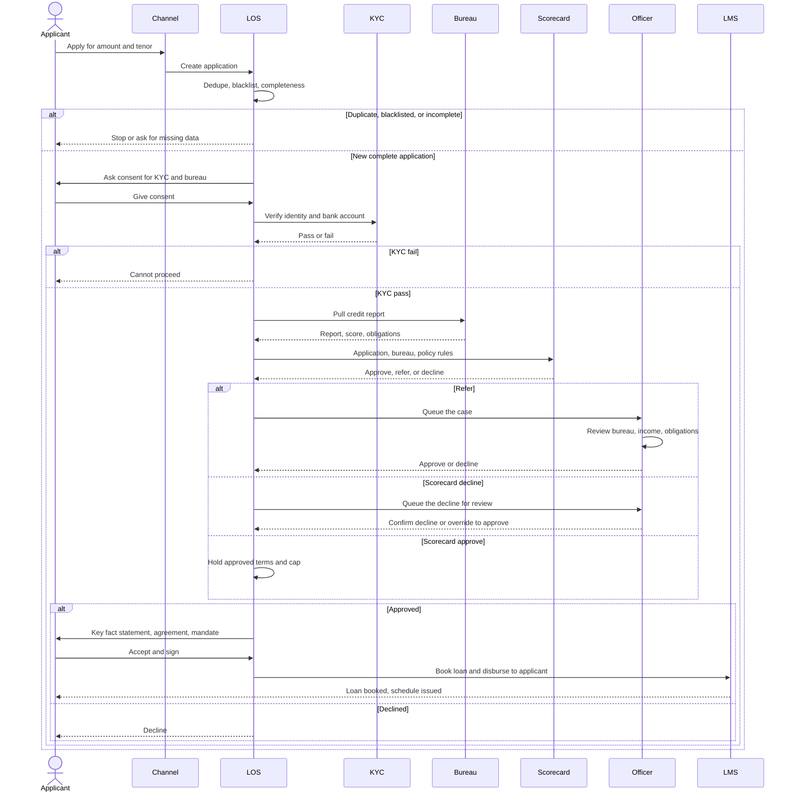
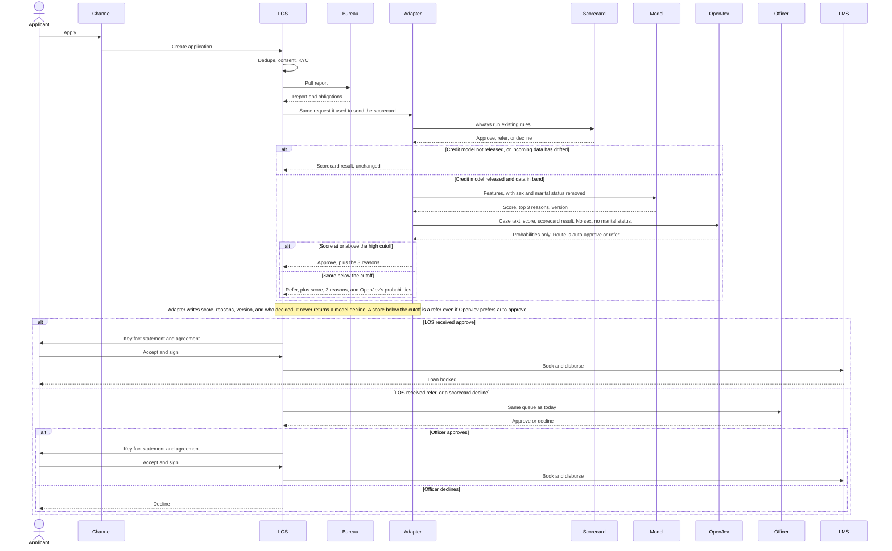
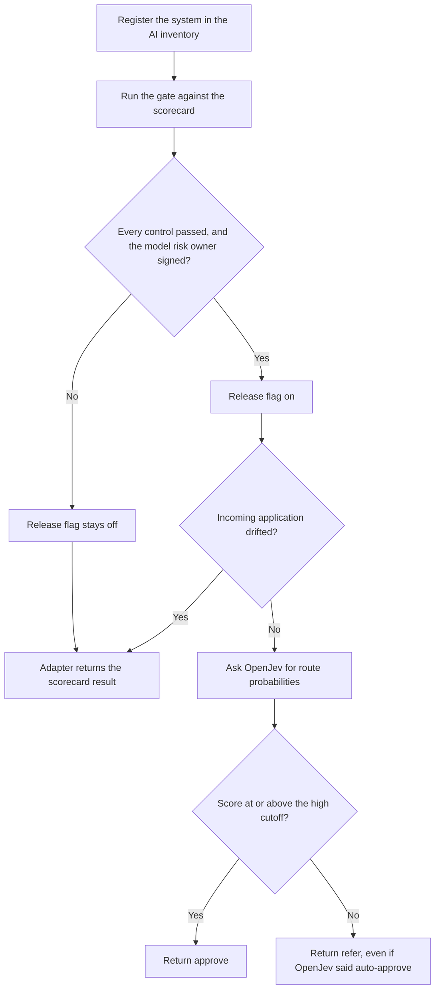
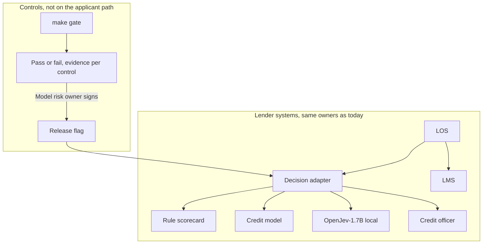

# Credit decision gate

An Indian lender making small personal loans has a credit scoring model that has only been scoring applications so far. The risk team now wants it to make decisions. Before that, someone has to show it is fair across groups, holds up when the data is slightly off, and beats the rule scorecard they use today. It also has to be logged in an AI inventory.

That is the job of this product: take this one scoring system from pilot to production with the right tests and controls, without replacing the systems that already book loans. The scorecard stays in place and remains the fallback.

The stand-in data is the public [Statlog German Credit](https://archive.ics.uci.edu/dataset/144/statlog+german+credit+data) dataset (UCI id 144, Hofmann 1994). 1,000 applications, 20 features, good/bad label, no missing values. Sex and marital status are one combined field (attribute 9). Age is attribute 13. Approving a bad loan is treated as five times worse than declining a good one.

## Who decides

| Who | What they decide |
| --- | --- |
| Rules | Sex and marital status are never model inputs. They are kept only for testing. Any failed control blocks go-live. If incoming data drifts, decisions fall back to the scorecard. |
| Credit model | Returns a risk score and its top 3 reasons. It may auto-approve only above a high score. It never declines anyone on its own. |
| OpenJev | Reads the case as text and answers typed questions with probabilities. It does not set the score, the cutoff, or the release flag. The adapter drops its answer when it conflicts with a rule. |
| Person | A credit officer decides borderline cases and every decline. The model risk owner signs off the go-live report. |

The cutoff for auto-approve is a number set with the risk team. It is not one of the gate targets below, and it is not a probability OpenJev picks.

While the model is live, a score below that cutoff goes to the officer even if the scorecard would have approved. The officer sees both results. The scorecard does not silently approve or decline that case. When the model is off, or the data has drifted, the scorecard result is returned unchanged and the existing path applies.

## Gate targets

These targets are product rules for this case, not numbers taken from a regulator or a job posting.

- The model separates good and bad loans with AUC at least 0.75, and at least 0.05 better than the scorecard.
- The approval ratio between groups stays between 0.80 and 1.25.
- No more than 5% of decisions flip when the input data is slightly noisy.
- Every control has evidence attached.

Kill rule. If one round of fixes cannot pass the fairness checks without dropping below those accuracy targets, the model does not go live. The lender keeps the scorecard plus officer review, and the failed gate is recorded.

A first run is expected to fail the age check for applicants under 25. Measure that on this build. Do not reuse a number from a prior trial.

## Scope

MVP, 1–2 hours.

- Train a simple model on German Credit and compare it to a rule scorecard baseline.
- Run fairness and robustness tests with Holistic AI's open-source `holisticai` library.
- Map each test to a control from the RBI FREE-AI framework or the EU AI Act.
- `make gate` writes a pass or fail report for each control and blocks go-live on any failure.

Stretch, 1–2 days. Not part of the first slice.

- Fix the failure the first run turns up, and report how much accuracy that fix costs.
- Wrap the model in a FastAPI scoring service.
- Before promoting any new version, replay past applications through it, then roll it out to 10% of traffic.
- Add the gate to CI.
- Add an LLM that drafts decline notes using only the model's 3 reasons. A person still owns the decline.

## What this is not

An Indian lender is already bound by the Digital Lending Guidelines, the Fair Practices Code, and IT outsourcing rules: direct disbursement to the applicant, a Key Fact Statement, a grievance path, and an audit trail of the decision. Those stay as they are.

RBI's FREE-AI framework (August 2025) and the EU AI Act are the control catalogs the gate maps tests onto. FREE-AI is not a binding circular in the way the Digital Lending Guidelines are. The EU AI Act high-risk rules for credit scoring (Annex III 5(b), Articles 9–15 and 26) do not bind this lender unless the system is placed on the EU market or its output is used in the EU. Mapping tests to those controls is in scope. Claiming they already legally apply is not.

## As-is flow

Today the rule scorecard is the decision engine. A credit officer handles what the scorecard will not clear. There is no model, no gate, and no AI inventory on this path.

Assumption used below, not yet confirmed: a clean scorecard pass is auto-approved. Only refers and declines go to an officer. If every file is manual today, the scorecard-approve branch also lands in the officer queue.

| System | What it does today | Decides the loan? |
| --- | --- | --- |
| Channel | App, partner, or branch. Collects the application. | No |
| LOS | Owns the file: dedupe, consent, calls to KYC and bureau, and the offer. | No |
| KYC | Checks identity and that the bank account is the applicant's. | No |
| Bureau | Returns the credit report, the bureau score, and existing obligations. | No |
| Scorecard | Live decision. Knockouts can decline. Points can approve or refer. Caps amount and tenor. | Yes |
| Officer | Reviews refers. A scorecard decline is also queued, so a person can confirm it or override it. | Yes |
| LMS | Runs only after acceptance. Books the loan, disburses to the applicant's own account, issues the schedule. | No |

## To-be flow

The applicant's steps do not change. The product sits in front of the scorecard the loan origination system (LOS) already calls, and it answers in the same language: approve, refer, or the scorecard's own result. The LOS, the officer queue, and the loan management system (LMS) stay. The model is not a new step the applicant sees.

| Stage | What the applicant does | What changes |
| --- | --- | --- |
| Apply | Same application, same channel | Nothing |
| Verify | Consent, KYC, bureau | Nothing. Sex and marital status stay on the application. They are stripped before the model is called, and kept only for offline tests. |
| Decide | Waits | Only insert. If the credit model is released and the data is in band, a high score comes back as an approval. Anything else comes back as a refer, never a decline. If the data has drifted, or the model is not released, the scorecard result is returned exactly as today. OpenJev may rank the route. It cannot change this outcome. |
| Offer or decline | Sees an offer, or a decline | An offer is still a Key Fact Statement and a signature. A decline is still a person. The model never sends the decline. |
| Disburse | Money to their own account | Nothing. The LMS still books only after acceptance. |

The adapter is the integration. The LOS does not learn a new system. It keeps calling the decision endpoint it already calls. That endpoint is wrapped.

- The scorecard always runs. Its result is the decision when the model is off, and context for the officer when the model is on.
- The credit model only scores. It does not approve or decline.
- A high score is mapped to the existing approve response.
- Any lower score is mapped to the existing refer response. That is how "the model never declines" is enforced without a new queue.
- A drift event, or a credit model that has not passed the gate, returns the scorecard result and stops. OpenJev is not called. The journey is then the one that already exists.
- OpenJev is asked only after the score and the scorecard result exist. Its route question has two options, auto-approve or refer. There is no decline option on the applicant path.
- The adapter ignores an OpenJev auto-approve when the score is below the cutoff, the model is unreleased, or the data has drifted. Those three checks are code, not a question.

The officer workbench can show the score, the three reasons, and OpenJev's probabilities when it is ready. Until then it still receives a refer, which it already knows how to work. The officer is the one who approves or declines that case. The LMS is not in this change.

## Release gate

This is not an applicant step. Until it passes, the adapter's release flag stays off and every application takes today's scorecard path.

`make gate` writes a pass or fail for each control, with evidence attached. Any failure blocks go-live. The model risk owner signs the report. A failed gate is recorded even when the kill rule sends the lender back to the scorecard.

## Where OpenJev sits

[OpenJev-1.7B](https://huggingface.co/alanhuangya/OpenJev-1.7B) is a local System One decision model: typed questions in, calibrated probabilities out, no text generated. Weights are Apache-2.0, on `Qwen/Qwen3-1.7B-Base`, about 3.5 GB. It is served with `wev serve` (package `openjev-ai`, imported as `wev`) at `POST /v1/systemone` on the lender's own machine. No API key, no hosted call. Independent of TypeSafe and of Jev. Huang and Ren, 2026, [doi:10.5281/zenodo.22941164](https://doi.org/10.5281/zenodo.22941164).

It is not the credit model. It was not trained on German Credit, and the gate's AUC target is measured on the tabular score, not on OpenJev. It also does not write the decline note. That stretch item stays a separate text model, fed only the three reasons.

What it does on this path is narrow. After the scorecard and the credit model have answered, the adapter sends a redacted case and two questions:

- `route`: choice of `auto_approve` or `refer_officer`. No decline option.
- `needs_more_info`: yes/no, shown to the officer with the probabilities. It does not change the response the LOS receives.

Sex, marital status, and raw KYC identifiers are not in that state. Age may be, because age is a normal underwriting feature and is the group the fairness check is expected to fail on. That is a case fact, not a reason to let OpenJev decide the loan.

Clamps, all in the adapter, all before the LOS sees a response:

- Release flag off, or drift: do not call OpenJev. Return the scorecard result.
- Score below the cutoff: return refer, even if OpenJev's highest probability is auto-approve.
- OpenJev down, slow, or malformed: return the score-and-cutoff result. Lending does not wait on it and does not fail open into an auto-approve.
- OpenJev never returns a decline to the LOS. The officer still decides every refer and every decline.

Both the credit model and OpenJev go in the AI inventory, with separate owners, purposes, and versions. The credit model is the system the gate blocks. OpenJev is recorded as an advisory scorer on the same decision, not as a second underwriting model.

Use constraint, from the model card: some of its training data is research-only, and some teacher traces are a provider's model outputs. Treat the 1.7B weights as a research artifact until those terms are checked. Do not put it on a production decision, even clamped, before that check. The MVP can call it locally for the route question and log the probabilities. Turning those probabilities into anything an applicant feels is out of scope until the terms and the gate both pass.

## Open points

1. Does the scorecard auto-approve clear passes today, or does an officer see every application?
2. Where does a shadow score land now, if one is already written: a notebook, a table, or an API the LOS ignores?
3. Which groups are in the fairness policy besides under 25? Sex is test-only, not an input.
4. Is the legal entity an NBFC or a bank? The EU mapping is a control catalog only unless that answer says otherwise.
